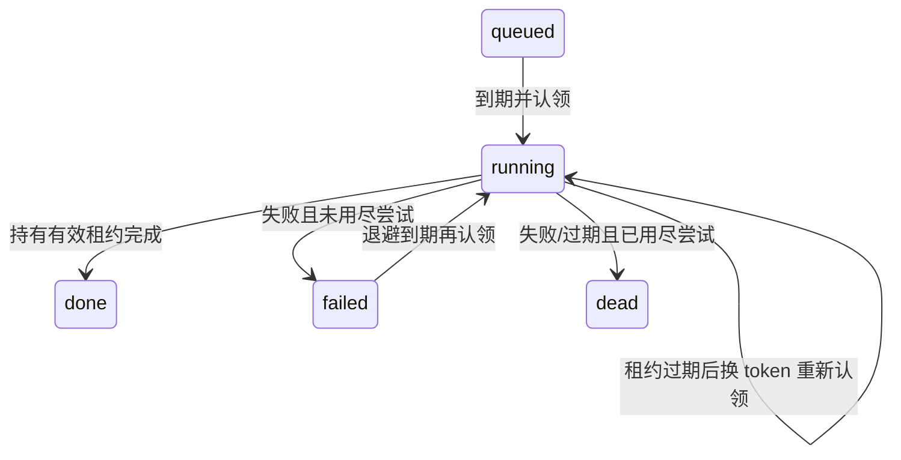

# 表驱动任务队列（#21，拆分 1/3）

本轮交付 `memory_tasks` 的迁移与内部仓储，owner 为 tasks（ADR-006）。
Refs #21，尚不关闭 Issue：worker、并发执行限制、周期调度与聊天 EXTRACT 的可靠接线分后续两轮完成。
现有进程内 `trackJob`/`extracted_at` 路径未改，不能用本轮合并宣称聊天任务已经不会因崩溃丢失。
不新增 Redis、依赖、公开 HTTP 端点或客户端命令，也不自动运行任何新任务。

## 任务与身份

`enqueueTask(db, input)` 严格校验输入，再验证项目/引用归属；返回 `{task, created}`。

| type            | payload                     | 本轮执行器 |
| --------------- | --------------------------- | ---------- |
| EXTRACT         | `{evidence_id: UUID}`       | 未接线     |
| REEMBED         | `{belief_version_id: UUID}` | 未接线     |
| DECAY           | `{}`                        | 未接线     |
| COMPILE_PROFILE | `{}`                        | 未接线     |

payload 只存引用，不复制 Evidence、prompt、模型回答、配置或候选正文。
JSON 引用不是数据库 FK：入队时在事务中沿消息→会话或版本→Belief 校验项目归属并加 key-share 锁；
未来 handler 执行时仍必须重新验证引用存在、归属正确且未被删除，不能信任旧 JSON。
项目列有 FK；本轮不改变硬删除传播（#11）或提供任意载荷透传。

幂等键在 `(project_id, type, idempotency_key)` 内唯一；1–200 个 ASCII 字母/数字/`._:-`，
应由受信代码用业务 ID 构造，不放正文或凭据。与 #42 的字段草案相比，明确为项目/类型作用域，
避免不同项目互相压制。done/dead 后键仍保留，不会因重复 enqueue 重新执行。
同键相同引用和重试配置返回旧任务；引用/重试配置冲突以固定 `task identity conflict` 拒绝，
不覆盖旧行。原 `run_at` 不因重复入队变化；需要新一次计划执行时用新的稳定幂等键。
这只是入队去重，不代表业务副作用已经 exactly-once。

## 状态与租约

`claimTasks(db, {projectId?, types?, limit?, leaseMs?})` 是内部 worker 原语；不传项目时可认领全库，
不是权限 API。类型数组必须非空且无重复；默认四种。limit 默认1、范围1–100，
租约默认30s、范围1ms–300s。以 DB 时钟判断到期，`FOR UPDATE SKIP LOCKED` 跳过其他认领者，
按 run_at/created_at/id 排序；每次认领增加 attempts（包括崩溃后重领）。
每次认领生成新 token；token 与 task/project 一起传给完成、重试和续租方法。

`completeTask` / `retryTask` / `renewTaskLease` 都要求 running、token 相同且租约未过期。
先取得行锁，再在新语句中复查 DB 时间：单个 UPDATE 的时间谓词可能在等待纯行锁前就被评估，
不能靠它保证“拿到锁时仍未过期”。过期/旧 token/项目不匹配返回 false 或 null，不改变任务。
调用者传入的租约身份在首次 await 前复制，避免等待时外部修改目标。
续租从当前 DB 时间计算，并用 greatest 保证不缩短已有租约。

默认 maxAttempts=5，可设1–100。`failed` 是等待退避，不是终态。
失败延时为 `min(backoffCapMs, backoffBaseMs * 2^(attempts-1))`，默认1s起、60s封顶；
策略持久化，每项1ms–24h且 base≤cap。重试不再持有 lease，run_at 到期后才能重领。
最后一次执行失败直接 dead；最后一次执行崩溃则在下一次 claim 的过期扫描中转 dead。
该扫描每批最多100行，与本次认领 limit 独立；大量过期行需要后续 claim 继续扫描。
因此没有 worker 调用 claim 时，过期状态不会自动变化；本轮没有定时清扫器。

`last_error_code` 只允许 HANDLER_FAILED/TIMEOUT/LEASE_EXPIRED，不存异常消息/堆栈或 provider 响应。
`listDeadTasks(db, {projectId, limit?, offset?})` 要求项目，默认50条、上限1000，按 created_at/id 稳定排序；
是内部查询方法，暂无公开死信重放端点。数据库检查 attempts/退避参数、payload 形状、lease/终态结构等。

## 后续验收与限制

1/3 真实 PG 测试覆盖重复迁移、并发入队/认领、显式锁跳过、租约过期后由新连接重领、
旧 token 拒绝、等待锁后过期的三种操作、指数退避/封顶、最终死信、分页与项目隔离。
新连接恢复证明持久层不依赖进程内状态，不等于完整 worker 进程重启验收。

2/3 将提供同进程 worker、执行并发限制、停止排空与周期任务调度；3/3 再接线 EXTRACT，
处理 handler 幂等、业务写入与任务回执、故障恢复，并终验 #21。
租约 token 目前只保护队列行：旧 worker 若继续执行外部副作用，不会自动被数据库撤销；
后续 handler 需用业务幂等键/事务及租约检查解决，不能将仓储层 fencing 冒充业务 exactly-once。
REEMBED/DECAY/COMPILE_PROFILE 在本轮只有类型与引用契约，不伪造尚未实现的业务处理结果。

任务表没有自动清理，幂等记录长期保留；保留/清理策略由后续运维需求决定。
回滚应用代码可以保留新增表和枚举，不自动删除已持久化任务。
测试使用隔离原生 PG 或 CI Testcontainers、离线模型，无付费模型调用、实际 .env 读取或用户服务重启。
