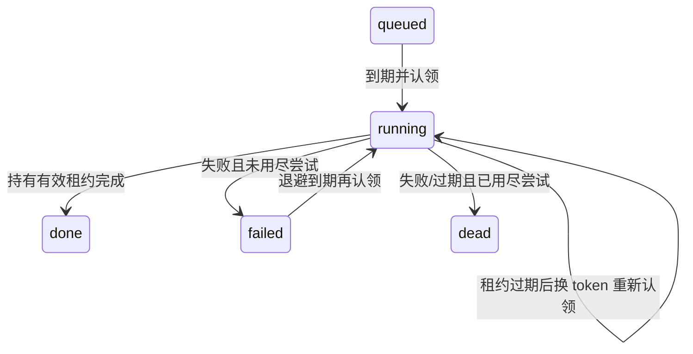

# 表驱动任务队列（#21）

已交付 `memory_tasks`、worker、周期调度及真实 EXTRACT/REEMBED 链路，owner 为 tasks（ADR-006）。
正式 `src/index.ts` 在 DB 与 master key 齐备时启用持久消费，不用空处理器伪造成功。
消息、文件 Evidence 和提取 outbox 同事务持久化；提取成功后才置 extracted_at。
库调用 `buildApp` 通过 `extractionQueue: {}` 显式启用，缺省保留兼容的进程内路径；
它与外部注入的 `taskWorker` 互斥。正式服务没有退回进程内写回的环境开关。
不新增 Redis、依赖或公开队列 HTTP 端点。

## 任务与身份

`enqueueTask(db, input)` 严格校验输入，再验证项目/引用归属；返回 `{task, created}`。

| type            | payload                     | 本轮执行器                       |
| --------------- | --------------------------- | -------------------------------- |
| EXTRACT         | `{evidence_id: UUID}`       | 真实提取、Gate、ingest、Resolver |
| REEMBED         | `{belief_version_id: UUID}` | 单版本派生索引写入               |
| DECAY           | `{}`                        | 未接线                           |
| COMPILE_PROFILE | `{}`                        | 未接线                           |

payload 只存引用，不复制 Evidence、prompt、模型回答、配置或候选正文。
JSON 引用不是数据库 FK：入队时在事务中沿消息→会话或版本→Belief 校验项目归属并加 key-share 锁；
handler 执行时仍会重新验证引用存在、归属正确且未被删除，不能信任旧 JSON。
项目列有 FK；本轮不改变硬删除传播（#11）或提供任意载荷透传。

幂等键在 `(project_id, type, idempotency_key)` 内唯一；1–200 个 ASCII 字母/数字/`._:-`，
应由受信代码用业务 ID 构造，不放正文或凭据。与 #42 的字段草案相比，明确为项目/类型作用域，
避免不同项目互相压制。done/dead 后键仍保留，不会因重复 enqueue 重新执行。
同键相同引用和重试配置返回旧任务；引用/重试配置冲突以固定 `task identity conflict` 拒绝，
不覆盖旧行。原 `run_at` 不因重复入队变化；需要新一次计划执行时用新的稳定幂等键。
入队去重本身不是业务幂等；真实提取还使用后文的事务回执与 Evidence 完成标记。

## 状态与租约

`claimTasks(db, {projectId?, types?, limit?, leaseMs?, excludeTaskIds?})` 是内部 worker 原语；不传项目时可认领全库，
不是权限 API。类型数组必须非空且无重复；默认四种。limit 默认1、范围1–100，
租约默认30s、范围1ms–300s。以 DB 时钟判断到期，`FOR UPDATE SKIP LOCKED` 跳过其他认领者，
按 run_at/created_at/id 排序；每次认领增加 attempts（包括崩溃后重领）。
每次认领生成新 token；token 与 task/project 一起传给完成、重试和续租方法。

`completeTask` / `retryTask` / `renewTaskLease` 都要求 running、token 相同且租约未过期。
先取得行锁，再在新语句中复查 DB 时间：单个 UPDATE 的时间谓词可能在等待纯行锁前就被评估，
不能靠它保证“拿到锁时仍未过期”。过期/旧 token/项目不匹配返回 false 或 null，不改变任务。
调用者传入的租约身份在首次 await 前复制，避免等待时外部修改目标。
续租从当前 DB 时间计算，并用 greatest 保证不缩短已有租约。

默认 maxAttempts=5，可设1–100。`failed` 是等待退避，不是终态。
失败延时为 `min(backoffCapMs, backoffBaseMs * 2^(attempts-1))`，默认1s起、60s封顶；
策略持久化，每项1ms–24h且 base≤cap。重试不再持有 lease，run_at 到期后才能重领。
最后一次执行失败直接 dead；最后一次执行崩溃则在下一次 claim 的过期扫描中转 dead。
该扫描每批最多100行，与本次认领 limit 独立；大量过期行需要后续 claim 继续扫描。
因此没有 worker 调用 claim 时，过期状态不会自动变化；worker 的每次认领复用此扫描。

`last_error_code` 只允许 HANDLER_FAILED/TIMEOUT/LEASE_EXPIRED，不存异常消息/堆栈或 provider 响应。
`listDeadTasks(db, {projectId, limit?, offset?})` 要求项目，默认50条、上限1000，按 created_at/id 稳定排序；
是内部查询方法，暂无公开死信重放端点。数据库检查 attempts/退避参数、payload 形状、lease/终态结构等。

## 后续验收与限制

1/3 真实 PG 测试覆盖重复迁移、并发入队/认领、显式锁跳过、租约过期后由新连接重领、
旧 token 拒绝、等待锁后过期的三种操作、指数退避/封顶、最终死信、分页与项目隔离。
新连接恢复证明持久层不依赖进程内状态，不等于完整 worker 进程重启验收。

## Worker 引擎（2/3）

`TaskWorker` 导出自 `apps/server/src/tasks/worker.ts`，要求 db 与至少一个受信 handler。
处理器按 EXTRACT/REEMBED/DECAY/COMPILE_PROFILE 注册；只认领注册表中的类型，未注册类型也
不会被该 worker 清扫或标成成功。注册表在构造时复制；原型上的属性不算注册。
每次 handler 获得独立的 task 副本和 `{signal: AbortSignal, checkpoint()}`，不能通过改写对象重定向回执。
执行前重新校验 payload 与引用归属；当前版本、软删除、业务写入等策略仍由具体 handler 负责。

| 设置          | 默认             | 范围                             |
| ------------- | ---------------- | -------------------------------- |
| concurrency   | 2                | 1–32，每个 worker 实例的执行上限 |
| leaseMs       | 30000            | 100–300000                       |
| heartbeatMs   | floor(leaseMs/3) | 正整数且小于 leaseMs/2           |
| pollMs        | 1000             | 10–60000                         |
| taskTimeoutMs | 300000           | 10–3600000                       |

`projectId` 可选，配置后只认领本项目，周期配置也必须属于本项目。
`tick()` 串行化一次“调度→空闲槽位认领”，重复并发调用不扩大并发；等待 handler 不占用认领事务。
`start()` 开始不重叠的轮询，重复 start 不建第二个循环；停止后的实例不可重新启动。
认领时以有界 excludeTaskIds（最多32个）排除本实例尚未退出的任务，包含过期扫描，
避免超时且不响应取消的任务在同实例被重领、覆盖原槽位。只有实际 promise 退出才释放槽位。
并发上限是本实例，不是跨进程的全局信号量；多个实例的总执行量由部署方控制。

心跳单飞，不积压续租请求。续租返回 false 或数据库失败时中止 signal，停止续租且不确认/重试
不确定的租约。超时中止 signal；handler 真正退出后，若仍持有有效租约才记录 TIMEOUT 并退避。
执行截止时间以 performance.now 单调时钟捕获，在 handler 前及退出时复查，
防止 CPU/连续微任务阻塞定时器后被误记成功。普通 handler 异常只写 HANDLER_FAILED。所有警告使用固定文案，logger 抛错不回退原始对象。

**取消是协作式的**：JavaScript Promise 不会被强制终止。不响应 signal 的 handler 继续占用本地槽位，
不能提前释放槽位后悄悄叠加新执行。超时会停止后续心跳；在途续租 SQL 仍可能完成一次。
其他 worker 可在租约过期后回收，因此具体 handler 仍须处理过期执行者可能产生的副作用。
队列 token 不自动撤销外部操作，也不是停止模型计费的证明。

`stop(timeoutMs=10000)` 停止发起新轮询和新周期入队，等待已发出的认领 SQL 与本地执行。
超时后中止信号、停止续租；迟到的认领不启动 handler，迟到 handler 不再确认/重试。
在途数据库语句不能被此接口撤回，可能留下 running 租约，待其他 worker 过期回收。
停机也使用单调截止时间，在认领返回、调用/确认前、心跳和最终结果处复查，防止延后的定时器放行迟到工作。
同步 CPU 工作无法被强制打断，可能延迟接口返回；事件循环恢复后仍按真实截止时间拒绝迟到回执。
返回 `{drained}` 表示本地工作是否全部结束，不表示全库队列清空或所有任务成功；重复 stop 复用结果。

Fastify 通过显式 `buildApp({taskWorker})` 在 ready 时启动、close 时排空，再等旧 chat jobs；
共用 shutdownDrainMs 的总时间上限；注入 worker 时该值须为0–60000的整数，否则在启动前拒绝。
worker 引用与排空预算在 buildApp 时捕获，外部修改 options 不会改变正在管理的实例。
`extractionQueue` 创建真实 EXTRACT/REEMBED worker，沿用相同生命周期和预算。

## 周期调度

`COMPILE_PROFILE` 周期配置包含 projectId/name/everyMs/可选 startsAt（UTC epoch 默认0）。
name 为1–64个 ASCII 字母/数字/`._-`，everyMs 为100ms–30天，startsAt 不早于 epoch；
每个引擎最多100份配置，同项目/name 不能重复。必须已注册 COMPILE_PROFILE handler。
目前没有 cron 语法、数据库配置 API、真实画像重写或默认空 handler。

调度器用 DB 时钟计算当前时间桶；幂等键包含 name、间隔、起点与桶号，run_at 是桶起点。
同桶跨 tick、跨实例、进程重启仍由队列唯一键去重。进程内游标只做优化且仅在入队成功后推进，
按配置数量有界；某个项目不存在/入队失败只跳过该项，本轮固定告警一次，健康配置继续入队。
停止信号在时钟读取后及每次入队前检查；已经发出的 SQL 可以完成，但不会继续产生后续项。

停机期间不补跑全部历史周期，只在恢复时为当前桶产生一份任务；轮询间隔长于周期时同样合并遗漏桶。
配置变更会产生新的时间桶身份；已经入队的旧任务不会自动删除。
设置合理间隔并管理保留策略，周期生产并不等于每个任务已执行；真实业务仍取决于注册 handler。

## 验收与限制

2/3 额外验证了真实独立 Node worker 进程：任务进入 handler 后 SIGKILL，队列仍为 running；
新进程等待租约到期，重领同一 ID，attempts=2，完成一条注入的离线审计副作用。
测试核对实际 worker PID，直接 node --import tsx 启动，避免仅杀掉 CLI 包装进程。
这证明 worker 的崩溃恢复链路，不冒充“业务写入成功但回执前崩溃”场景下的 exactly-once。

COMPILE_PROFILE 用注入的离线 handler 验证实际周期桶执行，不代表 #41 画像重写已实现。
DECAY 和真实画像编译不注册，业务实现分别归 #10/#41。单版本 REEMBED 不代表模型切换后的全量重嵌入工具。

任务表没有自动清理，幂等记录长期保留；保留/清理策略由后续运维需求决定。
回滚应用代码可以保留新增表和枚举，不自动删除已持久化任务。
测试使用隔离原生 PG 或 CI Testcontainers、离线模型，无付费模型调用、实际 .env 读取或用户服务重启。

## 真实提取与原子回执（3/3）

- JSON/SSE 在会话锁内一起写物理用户消息、脱敏文件和 `extract:<messageId>` outbox。
  回答失败、取消或进程退出不撤销已经准入的用户 Evidence；worker 可在回答完成前处理它。
- commit/resume 把归档、续聊引用和待提取物理 Evidence 入队放在同一事务；不复制或重新提取继承历史。
- 每次执行从库中重读项目/会话/消息及文件父引用，拒绝助手、普通 tool 和人工修正专用会话。
  文件权威强制 PROJECT_FILE。调用模型前和事务内都验证来源，内容发生变化则拒绝旧结果。
- 提取模型在业务事务外调用；格式反馈失败耗尽属于失败任务，走退避/死信，不当成成功空结果。
  已取消请求不发模型调用，取消后不再作反馈重试。用量观察独立记录真实调用，不随业务事务回滚。
- 同项目 durable worker 提交使用 advisory transaction lock，再锁会话、消息和任务；不同项目可并行。
  `completeTaskWith` 取得任务锁后用新语句复查 DB 时间，执行 DB-only 回调，最后再检查租约并标 done。
  Gate 审计/PENDING、Observation/Belief/版本/消解轨迹、REEMBED outbox、extracted_at、done 一起提交或回滚。
  末次 checkpoint 同步复查取消与单调截止时间；已发送的 COMMIT 无法撤回，不能承诺截止后的物理 I/O 为零。
- 已成功 Evidence 的其他任务直接完成，不再调用模型或 Gate；同 Evidence 并发投递也只提交一套业务效果。
  并发调用模型及提交前崩溃仍可能重复消耗 token，**不承诺付费调用 exactly-once**。
- 新版本的 `embed:<versionId>` 索引任务同事务入队。模型嵌入在锁外计算，事务内替换该版本索引并标 done。
  索引失败独立退避/死信，已写事实不重复佐证。语义召回有短暂索引延迟，期间仍可关键词召回；
  `memory.write.completed` 表示事实事务已提交，不代表派生向量已经可用。成功事件只在事务提交后发送。

启动及后续轮询会补齐历史 `extracted_at IS NULL` 且没有默认 EXTRACT 身份的物理用户/文件 Evidence，
每批最多100条，批次未满时30秒再检查；排除人工修正专用会话，不触碰既有 done/dead/failed 身份。
这会触发补处理历史消息的模型用量，应在部署前确认模型配置和待处理规模。
旧进程内路径曾提前写入的非空 extracted_at 无法判断是否真正成功，本轮不自动清空或重放；
需要操作者核查后修复。长期无模型配置或服务故障可耗尽重试进入 dead，配置修复不会自动重置死信。

真实子进程故障注入分别停在业务事务提交前、业务提交后而常规 worker 回执前，再 SIGKILL：
前者整体回滚并重领，后者任务已 done 不重复调用模型；两者最终均恰好一条 Observation、evidence_count=1
及一个索引 outbox。这不覆盖任意外部工具副作用；未来 handler 必须自己定义幂等提交协议。
